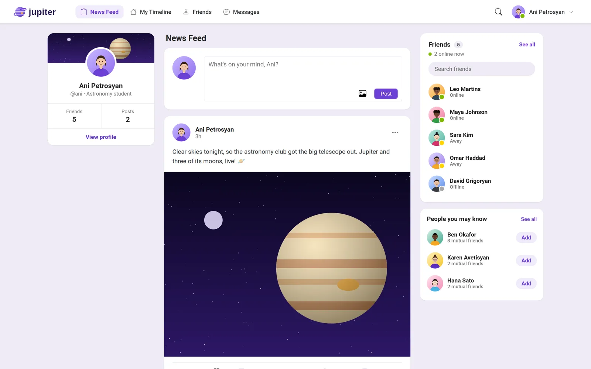
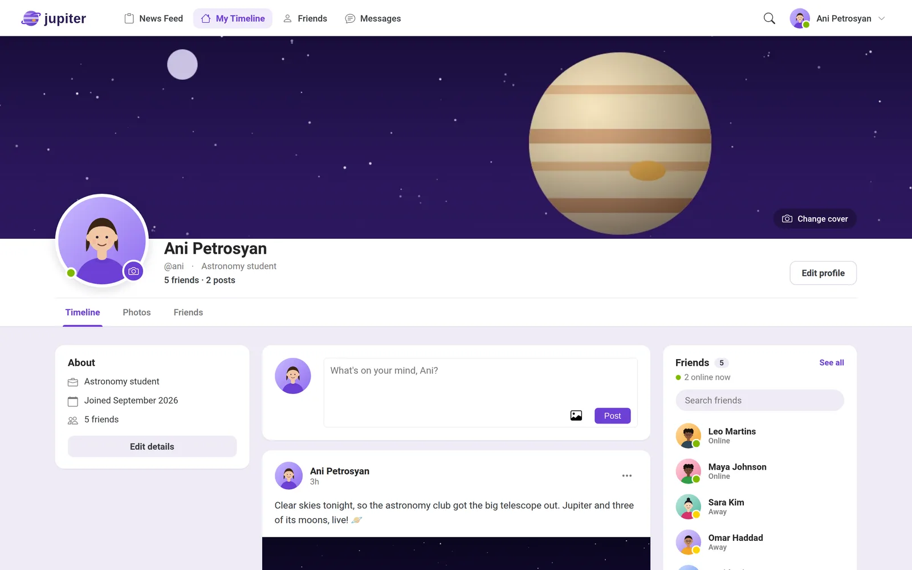
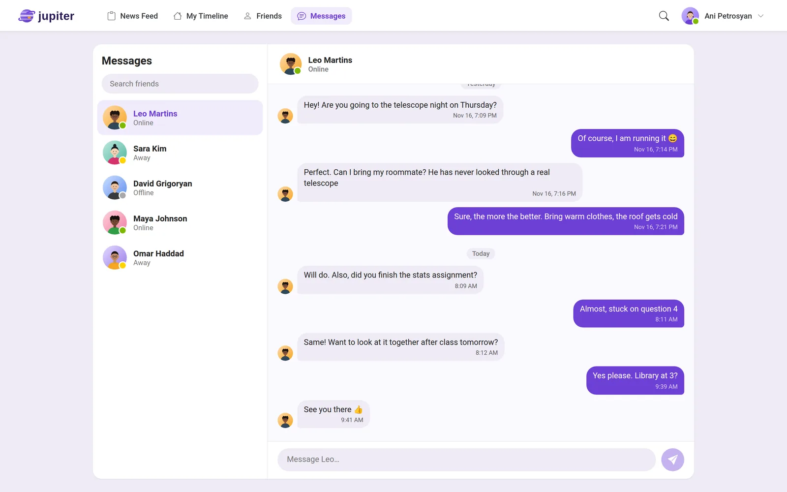
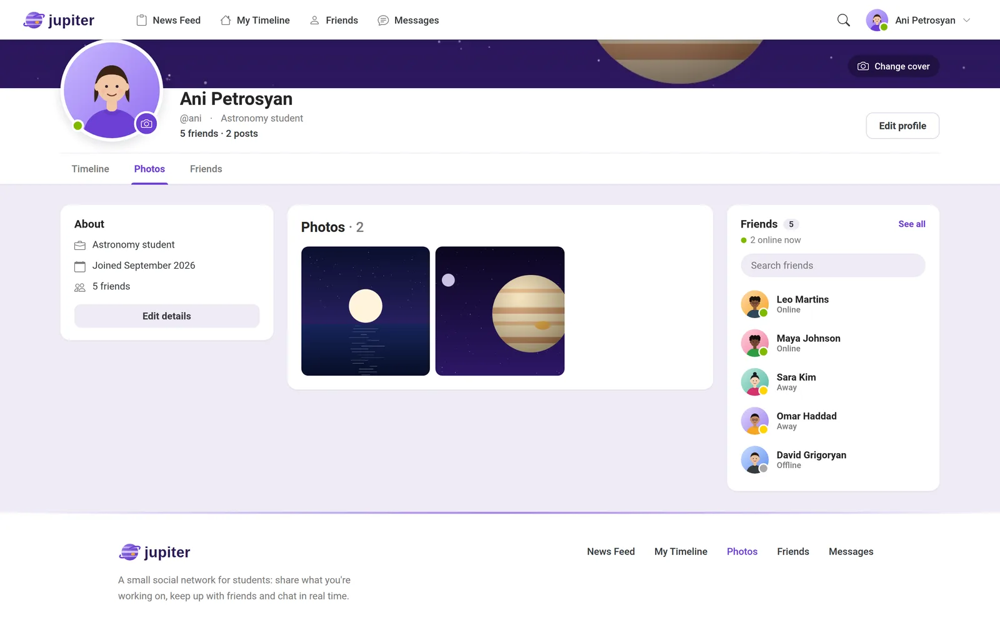
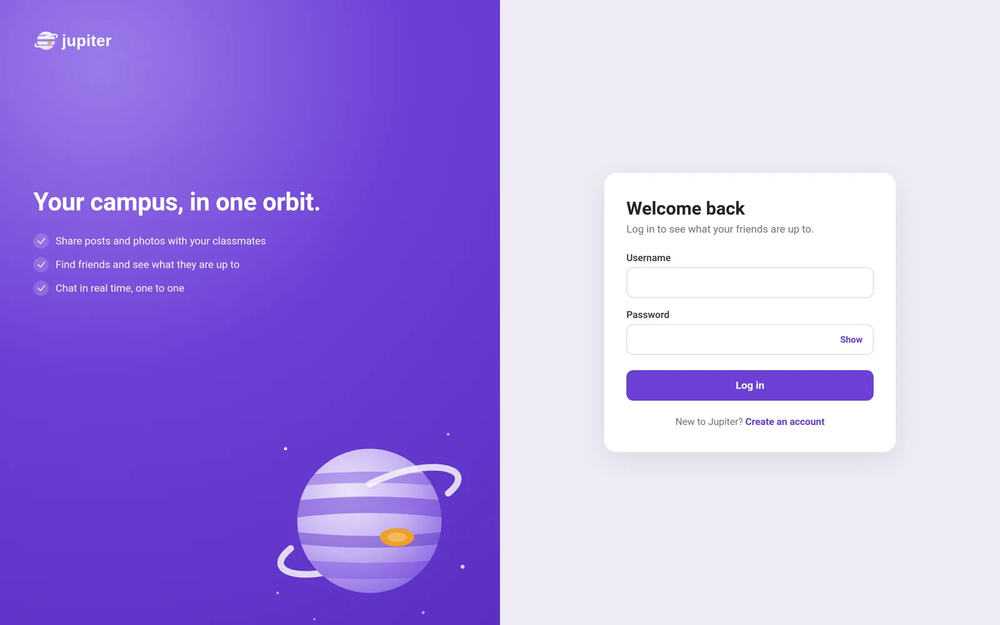
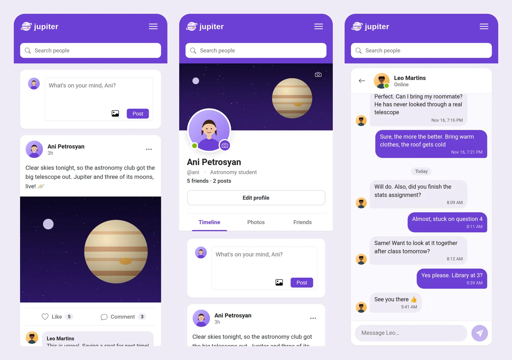

# Jupiter

A small social network for students: share posts and photos, find friends and chat in real time.

Built with **React + TypeScript** on the front end and **Node.js + Express + PostgreSQL** on the back end, with **Socket.IO** for live chat and **Supabase Storage** for images.



| Profile | Messages |
| --- | --- |
|  |  |
| **Photos** | **Log in** |
|  |  |

On phones it's a single column with a slide-out menu:



The screenshots show the [demo data](#demo-data).

## Features

- Sign up and log in; sessions renew silently
- Profiles with name, job, profile picture and cover photo; open anyone's profile to see their posts, photos and friends, and add them as a friend or message them
- Posts with text and/or a photo, likes, comments and replies
- Newsfeed, and a Photos page with your images
- Friend requests, suggestions ranked by mutual friends, and user search
- Private one-to-one real-time chat with friends, with saved history
- Online / away / offline status
- Responsive: three columns on desktop, two on tablets, one on phones

## Under the hood

- **Auth:** short-lived JWT access token (1 hour) plus a refresh token in an **httpOnly cookie** (1 day), so page scripts can never read it. Passwords are hashed with bcrypt (cost 12).
- **Abuse protection:** per-account login rate limiting (keyed on IP and username, so students on a shared campus IP don't lock each other out), validation of all auth input on the server, and one generic error for a wrong username or password.
- **Private chat:** the server decides which chat room a socket may join and builds every message itself, so nobody can read, post into or spoof someone else's conversation.
- **Images:** uploads are resized and converted to WebP with `sharp`, then stored in Supabase.
- **Database:** schema changes are versioned migrations (umzug), applied automatically on startup.
- **Tests:** unit tests plus an end-to-end suite that drives the real API, sockets and uploads.

## Repository layout

| Folder | What it is |
| --- | --- |
| [`frontend/`](frontend) | React 18 + TypeScript web app (Vite, Redux Toolkit, React Router, Formik + Yup, SCSS) |
| [`backend/`](backend) | Express API (Sequelize + PostgreSQL, Socket.IO, JWT, multer + sharp, Supabase Storage) |
| [`docker-compose.yml`](docker-compose.yml) | Runs the database, API and web app together |

## Quick start (Docker)

You need [Docker](https://docs.docker.com/get-docker/) and a Supabase project with a **public** storage bucket named `winku` that contains `default/pfp.jpg` and `default/cover.jpg` (the images new users start with).

```sh
cp backend/.env.example backend/.env    # fill in DB password, JWT secrets and Supabase keys
docker compose up --build
```

Open http://localhost:5173. The API is at http://localhost:8080. Code changes in `frontend/` and `backend/` reload automatically.

The database is created on first start (tables, roles), using the name, user and password from `backend/.env`.

### Demo data

A new database is empty. To fill it with a small university network (twelve students with friendships, posts with pictures, comments, likes and chats):

```sh
docker compose exec api npm run seed
```

Then log in as **`ani`** with the password **`Jupiter-demo1`** (every demo account uses it; usernames are `ani`, `leo`, `sara`, `david`, `maya`, `omar`, `nina`, `tom`, `lucy`, `hana`, `karen`, `ben`). Running it again replaces the demo data; other accounts are left alone. The avatars, covers and post pictures are drawn by the script and uploaded to the bucket's `demo/` folder. Without Docker, run `npm run seed` in `backend/`.

## Running without Docker

You need Node.js 20 (or 18.17+) and PostgreSQL.

```sh
# terminal 1: API
cd backend
cp .env.example .env    # fill it in; HOST=localhost
npm install
npm run dev

# terminal 2: web app
cd frontend
npm install
npm run dev
```

## Tests

```sh
cd backend
npm test                              # unit tests, no database needed
npm run test:e2e                      # end-to-end, against a running API (e.g. docker compose up)
RUN_UPLOAD_TESTS=1 npm run test:e2e   # also tests image uploads against Supabase (adds one small profile photo per run)
```

The frontend is checked with `npm run lint` and `npm run build` (which type-checks).

## Deployment notes

- **Frontend (Vercel):** `frontend/vercel.json` proxies `/api` to the backend, so the refresh cookie is first-party in every browser (Safari blocks third-party cookies). Replace the placeholder backend address in `vercel.json`, set `VITE_API_URL` to empty and `VITE_SOCKET_URL` to the backend URL.
- **Backend (e.g. Render):** set `NODE_ENV=production`, `CORS` to the frontend URL, and the variables from `backend/.env.example`. Migrations run on startup.

## History

Jupiter started as **Winku**, a university project by Arno Sahakyan with separate frontend and backend repositories. It was then rebranded, hardened and merged into this repository with both histories preserved.
